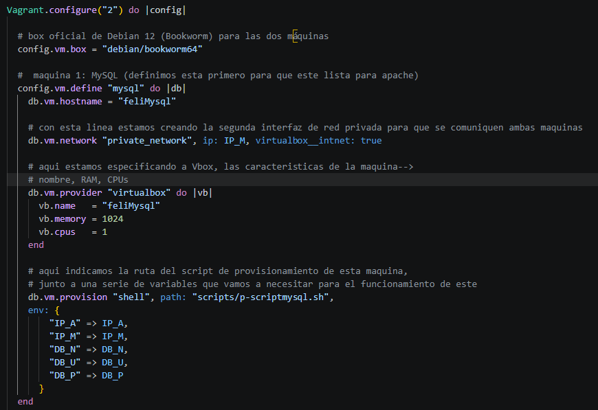

# Pila Lamp en dos niveles

# Introducción y arquitectura

En esta práctica desplegamos la aplicación de gestión de usuarios del repositorio [iaw-practica-lamp](https://github.com/josejuansanchez/iaw-practica-lamp) sobre una pila LAMP repartida en dos niveles: dos máquinas virtuales Debian 12 creadas con Vagrant (proveedor VirtualBox) y configuradas automáticamente mediante scripts de bash.

- **L**inux: Debian 12 (box `debian/bookworm64`).
- **A**pache: servidor web.
- **M**ariaDB: base de datos. Debian 12 no incluye MySQL en sus repositorios oficiales, por lo que usamos MariaDB, que es compatible con MySQL (mismo cliente, mismo puerto y misma sintaxis).
- **P**HP: ejecuta la aplicación y se conecta a la base de datos.

## -Máquinas

| Máquina | Función | IP red interna | Internet |
| --- | --- | --- | --- |
| feliApache | Front-end: Apache + PHP + aplicación | 192.168.10.11 | Sí (NAT) |
| feliMysql | Back-end: MariaDB | 192.168.10.12 | No |

```
Navegador del anfitrión
        │  http://localhost:8080  (reenvío de puertos 8080 → 80)
        ▼
┌────────────────┐     red interna (3306)     ┌────────────────┐
│   feliApache   │ ─────────────────────────▶ │   feliMysql    │
│ 192.168.10.11  │                            │ 192.168.10.12  │
└────────────────┘                            └────────────────┘
        │ NAT                                   sin salida a Internet
        ▼
    Internet
```

- Las dos máquinas se comunican por una red interna de VirtualBox, a la que no se puede acceder ni desde el anfitrión ni desde Internet.
- Solo feliApache tiene salida a Internet. A la aplicación se accede desde el anfitrión mediante el reenvío de puertos `localhost:8080 → 80`.
- Vagrant añade a cada máquina un adaptador NAT que usa para conectarse por SSH. En feliMysql lo mantenemos para poder gestionarla, pero al final del aprovisionamiento le quitamos la ruta por defecto, por lo que no tiene salida a Internet.
- El usuario de la base de datos (`lamp_user`) solo puede conectarse desde la IP de feliApache.

## -Estructura de archivos

```
.
├── README.md
├── Vagrantfile
└── scripts/
    ├── p-scriptmysql.sh
    └── p-scriptapache.sh
```

- `Vagrantfile`: define las dos máquinas (box, hostname, red, recursos y script de aprovisionamiento) y las variables compartidas (IPs, base de datos, usuario y contraseña), que se pasan a los scripts.
- `scripts/p-scriptmysql.sh`: aprovisiona feliMysql (MariaDB, base de datos, usuario y corte de Internet).
- `scripts/p-scriptapache.sh`: aprovisiona feliApache (Apache, PHP, despliegue y configuración de la aplicación).
- `README.md`: este documento técnico, junto con las capturas y el screencast.

> Nota: las credenciales del Vagrantfile son de prueba para un entorno local. En un entorno real se guardarían en un fichero `.env` excluido del repositorio.
> 

---

# Vagrantfile

Lo primero que vamos a estar configurando va a ser nuestro “vagrantfile”, en el que estaremos indicando que estaremos usando Debian 12 como nuestra box para ambas maquinas, para pasar a la configuración de la maquina de MySQL, en la que primero configuramos el nombre de la maquina, seguido de la configuración de la interfaz privada para la comunicación entre maquinas (ahora no podemos cortarle a esta maquina la salida a internet ya que en la parte de aprovisionamiento se tendrán que descargar paquetes, por lo que le cortaremos la salido mas adelante), seguido de las especificaciones de nuesta maquina (VirtualBox), y acabamos indicando donde esta el script de provisionamiento y definiendo las variables para el script que tenemos ya definido en el vagrantfile —>



Toda esta estructura de configuración de la maquina con MySQL, se estará usando para la maquina con Apache, cambiando solo IPs, nombres de maquina y ruta de aprovisionamiento, añadiendo la linea en la que configuramos el reenvío de puertos—>


---

---

# Aprovisionamiento MySQL

En nuestro script de aprovisionamiento MySQL (Mariadb), el cual estará dentro de la carpeta “scripts”, como bien podemos ver en la ruta que especificamos en el vagrantfile, estaremos primero actualizando las listas de paquetes para poder descargarnos los 2 paquetes que necesitaremos para el aprovisionamiento (mariadb-server y git), con los paquetes ya descargados pasamos a editar el archivo de configuracion “50-server.cnf”, lo único que cambiaremos de este sera el campo de “bind-address” por la ip de nuestra maquina, con este cambio realizado hacemos un restart para aplicar cambios, seguimos con la creación de la BD, poder importar el esquema de tablas dentro de esta (esquema el cual sacamos de descargarnos el repo indicado en el enunciado), con el esquema de tablas ya importado pasamos a la creación del usuario a atreves del cual se va a conectar apache y acabar cortando la salida a internet, tanto en esta sesión como si reiniciamos la maquina—>

```bash
#!/bin/bash

# actualizar la lista de paquetes e instalamos los paquetes necesarios-->
# mariadb-server (servidor de bd que tambien incluye cliente mysql) y 
# git (para clonar la aplicacion)
apt-get update
apt-get install -y mariadb-server git

# permitimos la conexion cambiando el contenido del campo "bind-address"
# por la ip de la maquina (red interna) en el archivo de configuracion
# seguido de un reinicio de mariadb
sed -i "s/^bind-address.*/bind-address = $IP_M/" /etc/mysql/mariadb.conf.d/50-server.cnf
systemctl restart mariadb

# creamos una bd con la variable de vagrantfile
mysql -e "CREATE DATABASE IF NOT EXISTS $DB_N;"

# y ahora con la bd ya creada clonamos el repositorio dentro de la carpeta tmp
# para importar el esquema de tablas dentro de la bd creada
git clone https://github.com/josejuansanchez/iaw-practica-lamp.git /tmp/pila-lamp
mysql "$DB_N" < /tmp/pila-lamp/db/database.sql
# eliminamos el clon del repo en tmp
rm -rf /tmp/pila-lamp

# creamos el usuario de la bd con las variables de vagrantfile
# para poder conectarnos desde apache, dandole permisos totales
# a la bd de la aplicacion importada
mysql <<EOF
DROP USER IF EXISTS '$DB_U'@'$IP_A';
CREATE USER '$DB_U'@'$IP_A' IDENTIFIED BY '$DB_P';
GRANT ALL PRIVILEGES ON $DB_N.* TO '$DB_U'@'$IP_A';
FLUSH PRIVILEGES;
EOF

# prevenimos que haya salida a internet una vez se reinicie la maquina
# no dejando al DHCP que vuelva a poner la puerta de enlace
echo "unset new_routers" > /etc/dhcp/dhclient-enter-hooks.d/del-gateway
# borramos la ruta por defecto actual que es la que nos da salida a internet
ip route del default
```

---

---

# Aprovisionamiento Apache

En nuestro script de aprovisionamiento Apache, el cual estará dentro de la carpeta “scripts”, como bien podemos ver en la ruta que especificamos en el vagrantfile, en este al igual que con el de aprovisionamiento de MySQL, empezaremos actualizando la lista de paquetes y descargando los paquetes necesarios (esta vez son mas de 2, se podrán ver mas adelante), seguido de clonar el repositorio que se nos indica en el enunciado para poder copiar la aplicación web en la raíz del servidor web habiendo borrado “index.html” (el cual nos crea apache por defecto), seguido de unos retoques en el archivo “config.php” para que pueda comunicarse con la BD de feliMysql en vez de la de la misma maquina (así viene configurado por defecto), definiendo la ip de la maquina feliMysql, el nombre de la BD y el usuario y contraseña que creamos en el anterior aprovisionamiento para que esta maquina pudiese conectarse a feliMysql (todos estos datos los sacamos de las variables creadas en el vagrantfile), para acabar haciendo propietarios de los archivos de la web al usuario de apache y reiniciando el servicio apache—>

```bash
#!/bin/bash

# actualizamos la lista de paquetes e instalamos los paquetes necesarios-->
# apache2 (servidor web), php y libapache2-mod-php (para que apache ejecute php),
# php-mysql (para que php se conecte a la bd) y git (para clonar la aplicacion)
apt-get update
apt-get install -y apache2 php libapache2-mod-php php-mysql git

# clonamos el repositorio de la aplicacion dentro de la carpeta tmp
git clone https://github.com/josejuansanchez/iaw-practica-lamp.git /tmp/pila-lamp

# eliminamos la pagina por defecto de apache y copiamos la aplicacion
# (carpeta src del repo) a la raiz del servidor web
rm -f /var/www/html/index.html
cp -r /tmp/pila-lamp/src/* /var/www/html/

# eliminamos el clon del repo en tmp
rm -rf /tmp/pila-lamp

# ajustamos el config.php de la aplicacion con las variables de vagrantfile
# para que se conecte a la bd de la otra maquina
sed -i \
  -e "s/define('DB_HOST', '.*')/define('DB_HOST', '$IP_M')/" \
  -e "s/define('DB_NAME', '.*')/define('DB_NAME', '$DB_N')/" \
  -e "s/define('DB_USER', '.*')/define('DB_USER', '$DB_U')/" \
  -e "s/define('DB_PASSWORD', '.*')/define('DB_PASSWORD', '$DB_P')/" \
  /var/www/html/config.php

# damos la propiedad de los archivos de la web al usuario de apache
chown -R www-data:www-data /var/www/html

# reiniciamos apache para aplicar los cambios
systemctl restart apache2
```

---

---

# Comprobaciones

Lo primero de todo es iniciar ambas maquinas con un `vagrant up`,  una vez han acabado de iniciarse vamos a comprobar su estado—>


---

## -MySQL

Accedemos por ssh a la maquina “mysql” con—> `vagrant ssh mysql`

Mostramos el hostname y la configuracion de red—>


Pasamos a demostrar que hemos cortado la salida a internet pero si vemos a la otra maquina (apache)—>


Demostramos que estamos escuchando por el puerto por defecto de MySQL (es el mismo para MariaDB) y mostramos el estado de mariadb—>


Accedemos a la BD con `sudo mysql`, una vez dentro mostramos las BD, las tablas dentro de “lamp_db”, los usuarios—>


---

## -Apache

Accedemos por ssh a la maquina “apache” con—> `vagrant ssh apache`

Mostramos el hostname y la configuración de red—>


Comprobamos que tenemos salida a internet y vemos la maquina “mysql”—>


Mostramos el estado de “apache2”—>


---

## -Anfitrión

Comprobamos que podemos ver la aplicación web en nuestro host en el buscador con la dirección “[http://localhost:8080/](http://localhost:8080/)”—>


---

# Incidencias

**-Se realizo la tarea sin sufrir ninguna incidencia**


[Ver screencast](screencash.mp4)
